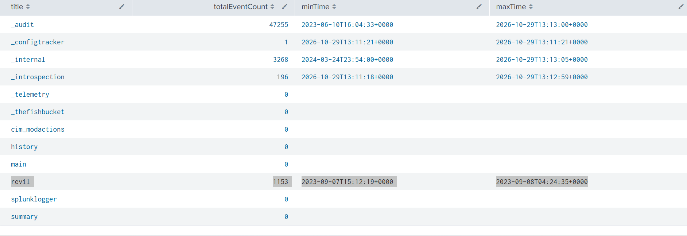

# REvil - GOLD SOUTHFIELD Lab



## Introduction

**REvil - GOLD SOUTHFIELD Lab** is a Threat hunting lab on **[CyberDefenders](https://cyberdefenders.org/blueteam-ctf-challenges/revil-gold-southfield/).** The company users started reporting ransom notes and background change on their workstations, a pattern that suggest a ransomware attack. 

## Orientation

First we need to enumerate the available indexes to understand what data we have. this will help us know where we should look when hunting. 

```jsx
| rest /services/data/indexes
| table title totalEventCount minTime maxTime
```



The index `revil` is going to be the main hunting index.

The index `revil` contains one source of logs: `winlog.ndjson` 

```jsx
index="revil"
| stats count by source
```


We can then enumerate the fields available in the `winlog.ndjson` source

```jsx
index="revil" source="winlog.ndjson" 
| fieldsummary 
| table field
```


## The investigation

### Q1) To begin your investigation, can you identify the filename of the note that the ransomware left behind?

As we are dealing with a ransomware attack, we know that it drops ransomware notes on the affected machines after encryption. We can hunt for it using Sysmon event ID 11. Moreover, we can search for file names that contain README.

```jsx
index="revil" source="winlog.ndjson" winlog.event_id=11 winlog.event_data.TargetFilename="*readme*"
| table _time, winlog.event_data.Image, winlog.event_data.TargetFilename
```


From the executable’s path, the ransomware was probably downloaded online.

### Q2) After identifying the ransom note, the next step is to pinpoint the source. What's the process ID of the ransomware that's likely involved

As we’ve already identified the process responsible for dropping the ransomware note, we can hunt its execution using Sysmon event id 1.

```jsx
index="revil" source="winlog.ndjson" winlog.event_id=1 winlog.event_data.Image="*facebook assistant.exe*"
| table _time, winlog.event_data.ParentImage, winlog.event_data.ParentUser, winlog.event_data.ProcessId, winlog.event_data.Image, winlog.event_data.CommandLine
```


The ransomware was spawned as a child of explorer.exe, which suggests that it was launched with a double click under the Administrator.

### Q3) Having determined the ransomware's process ID, the next logical step is to locate its origin. Where can we find the ransomware's executable file?

We have already identified the executable responsible for dropping the ransom note through the Sysmon events 11 and 1.

### Q4) Now that you've pinpointed the ransomware's executable location, let's dig deeper. It's a common tactic for ransomware to disrupt system recovery methods. Can you identify the command that was used for this purpose?

Ransomware mostly deletes shadow copies in order to inhibit system recover. We can list the child processes of the ransomware process by hunting Sysmon event id 1 process creation with a parent process.

```jsx
index="revil" source="winlog.ndjson" winlog.event_id=1 winlog.event_data.ParentImage="C:\\Users\\Administrator\\Downloads\\facebook assistant.exe"
| table _time, winlog.event_data.ParentImage, winlog.event_data.ParentUser, winlog.event_data.ProcessId, winlog.event_data.Image, winlog.event_data.CommandLine
```


The ransomware launches a base64 encoded command which deletes shadow copies.


### Q5) As we trace the ransomware's steps, a deeper verification is needed. Can you provide the sha256 hash of the ransomware's executable to cross-check with known malicious signatures?

One of the fields that Sysmon Event id 1 offers is the Hash, we can use it to search for the executable on threat intelligence platforms such as VT.

```jsx
index="revil" source="winlog.ndjson" winlog.event_id=1 winlog.event_data.Image="C:\\Users\\Administrator\\Downloads\\facebook assistant.exe"
| table _time, winlog.event_data.Image, winlog.event_data.Hashes
```


### Q6) One crucial piece remains: identifying the attacker's communication channel. Can you leverage threat intelligence and known Indicators of Compromise (IoCs) to pinpoint the ransomware author's onion domain?

Searching the SHA256 Hash obtained in the previous step, we find a [report](https://app.any.run/tasks/d39fb13c-4736-42ce-96bf-815c766a1e3e/) from Anyrun. We can read the dropped ransom note which contains the Threat actor’s onion domain.


